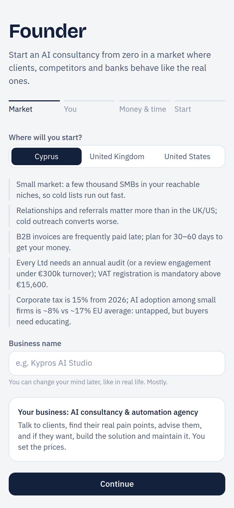

# Founder

**A phone-first business simulation where LLM agents play the people, and a deterministic engine decides what actually happens.**

Start an AI consultancy from zero in a market (Cyprus, UK or US) where clients, competitors, banks and employees behave like the real ones. Talk to clients to find their real pain points, write proposals, deliver, get paid (late), hire, borrow and try not to run out of savings.



## The agent design

The interesting part is how the AI is constrained. Language models are persuadable; a simulation that lets a clever sentence win a contract teaches the wrong lesson. So the work is split:

```
                ┌──────────────────────────────────────────────┐
  founder ───►  │  deterministic engine  (src/engine, no AI)   │ ──► every outcome:
                │  seeded RNG · calibrated base rates          │     replies, budgets, wins,
                └───────────────┬──────────────────────────────┘     delays, payments, churn
                                │ hidden truth (pains, budget ceiling, openness)
                                ▼
                ┌──────────────────────────────────────────────┐
                │  LLM agents  (src/app/api/*)                 │ ──► voice only: calls,
                │  prospects · negotiators · candidates ·      │     negotiation, interviews,
                │  mentor · chief-of-staff assistant           │     advice
                └──────────────────────────────────────────────┘
```

- **The engine decides, the agents act it out.** `src/engine/` (about 3,700 lines of pure TypeScript) decides who replies, what a client really needs and can pay, whether a proposal is accepted, how long a project really takes, and when invoices get paid. Agents receive that hidden truth and play it in character, so phrasing can't buy a "yes" the numbers don't support.
- **A tool-using assistant with a human approval gate.** Your chief-of-staff is a Claude agent with a read tool (`get_details`) and 28 action tools generated from the same registry the UI uses (`src/engine/actions.ts`). Reads run automatically; any tool call that changes the business pauses the loop until you approve or decline it, and a decline goes back to the model as a tool result.
- **Grounded persona from real documents.** `/api/persona` reads your CV and LinkedIn PDFs (sent as document blocks) plus your GitHub username, and turns them into a founder profile that drives call quality, estimates, credibility and your warm network.
- **Production details.** Prompt caching on every agent call, per-role effort levels (low for NPC dialogue, medium for the assistant), typed error handling for rate limits, auth and refusals, and the model set in one env var.

## Realism, tested

Base rates come from published benchmarks: cold email reply rates, proposal win rates, sales cycles, Cyprus tax, VAT and payroll, late-payment data and overrun studies. They're listed with sources in `src/engine/calibration.ts` and in the app under **More → Reality check**.

`npm test` plays hundreds of seeded games with a bot founder and checks the outcomes stay inside real-world ranges: about 1 meeting per 100 cold emails, about 37% discovery-to-proposal, about 23% win rate for a new firm, 3 to 4 months to a first client (mostly from the warm network). Overpricing and having no network are punished.

What it can't do: prove that *your* offer has demand. It tells you whether a plan works under realistic base rates; the mentor's "what should I verify in real life" turns a run into a checklist for the real world.

## Run it

Node.js 20.9 or later.

```bash
npm install
cp .env.example .env.local   # then set ANTHROPIC_API_KEY
npm run dev:phone            # serves on 0.0.0.0:3210
```

Open `http://<this-computer's-LAN-IP>:3210` on your phone (same Wi-Fi) and use **Add to Home Screen** to install it as an app. Saves live in the browser's IndexedDB on that device.

| Variable | Purpose |
|---|---|
| `ANTHROPIC_API_KEY` | Required for the agents |
| `AGENT_MODEL` | Model for every agent (default `claude-haiku-5-5`) |

```bash
npm test        # calibration and realism tests (vitest)
npm run lint
npm run build
```

## Layout

```
src/engine/        deterministic simulation: markets, sales, delivery, finance, team, events, calibration
src/app/api/       agent endpoints: npc, assistant, mentor, assess, persona
src/lib/prompts.ts system prompts built from engine state
src/components/    phone UI: Today, Pipeline, Work, Money, Assistant
```

Built with Next.js, React, TypeScript, Tailwind CSS and the Anthropic SDK.

## License

Founder is licensed under the [PolyForm Noncommercial License 1.0.0](LICENSE): free for personal, research, education and other noncommercial use. It is source-available, not an OSI-approved open-source license.

**Commercial use requires a separate license.** Contact Charalambos Rotsides at [lhampis@gmail.com](mailto:lhampis@gmail.com).
